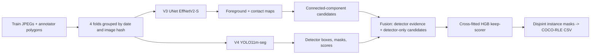

# SFSC 2026: Solar Filament Instance Segmentation

Our solution (team **ChaiPani**) to the [Solar Filament Segmentation Challenge 2026](https://www.kaggle.com/competitions/filament-segmentation-2026/overview) on Kaggle. The task is to find each individual solar filament in 2048 × 2048 GONG H-α full-disk images, scored by panoptic quality (PQ) against one to three independent human annotators.

The final system (**V4**) has three parts:

- a four-fold UNet (EfficientNetV2-S) that draws every mask;
- a four-fold YOLO11m-seg detector that supplies evidence about which objects exist;
- a cross-fitted gradient-boosted *keep-scorer* that decides which candidates to submit.

| | PQ | SQ | RQ |
|---|---:|---:|---:|
| **V4, cross-fitted out-of-fold (707 images, 1,154 annotator records)** | **0.455** | 0.682 | 0.668 |
| V4, public leaderboard | 0.40 | | |
| Human vs. human (one annotator scored against another, same images) | 0.340 | 0.634 | 0.536 |

All training runs in **Google Colab notebooks on a single NVIDIA L4**. The technical report is in [`report/`](report/) ([PDF](report/main.pdf)).

---

## Contents

- [Repository layout](#repository-layout)
- [Method](#method)
- [Results](#results)
- [Reproducing on Google Colab](#reproducing-on-google-colab)
- [Evaluation beyond the leaderboard](#evaluation-beyond-the-leaderboard)
- [What did not work](#what-did-not-work)
- [Data and rules](#data-and-rules)
- [License](#license)

## Repository layout

```
v1/  DeepLabV3 / ResNet50 + CLAHE baseline                 (historical)
v2/  DeepLabV3+ / ResNet50                                  (historical)
v3/  UNet / EfficientNetV2-S, 4 folds        -> dense maps  (final, stage 1)
v4/  YOLO11m-seg, 4 folds + fusion + scorer  -> submission  (final, stage 2)
v5/  post-V4 experiments (refiners, seeds, loss pilot, R34 ensemble); none adopted
v6/  BiCC component-loss pilot; not adopted
eval/    morphology evaluation of the frozen OOF predictions (CPU notebook + module + results)
report/  LaTeX source and PDF of the technical report (organizers' ACM template)
tools/   inference benchmark notebook
docs/    dependency, efficiency and licensing notes
requirements.txt             pinned direct dependencies
requirements-colab-cuda.txt  CUDA overlay for Colab GPU runtimes
```

Only `v3/` and `v4/` are needed to reproduce the final submission.

## Method



**Metric-driven design.** PQ pools matched IoU and TP/FP/FN over every annotator record, and predicted masks must not overlap. A kept candidate adds ½ to the denominator whether or not it matches. Keeping a candidate therefore pays off only if its expected matched IoU, averaged over annotators, is above PQ/2. So we separate *drawing* masks (a dense network) from *deciding* which to keep (a calibrated scorer). Every threshold is chosen on out-of-fold data.

**Preprocessing.** The solar disk is fitted with a circle and the image is flattened for limb darkening. The network receives three channels: raw intensity, flattened intensity and normalised radius r/R.

**V3 dense model.** A UNet with an ImageNet-21k EfficientNetV2-S encoder (timm / segmentation-models-pytorch) and scSE attention.
- **Targets:** a soft multi-annotator foreground target, plus an auxiliary *contact* head that separates touching filaments.
- **Loss:** soft BCE + Lovász hinge + edge BCE + contact BCE.
- **Training:** 768 px crops, EMA, 40 epochs per fold.
- **Inference:** 1024 px tiles at stride 768 with 8-way D4 test-time augmentation. Hysteresis on the foreground map is followed by a split at contacts.

**V4 detector evidence.** YOLO11m-seg is trained at 1280 px on the same folds. Detector score, overlap and coverage are added to twelve geometric and intensity features of each UNet component. A few detector-only candidates are added as well.

**Keep-scorer.** A histogram gradient-boosted regressor predicts each candidate's mean matched IoU across annotators. It is fitted out of fold and weighted by annotator-record count. Candidates scoring above the break-even threshold (τ = 0.225) are kept. The kept masks are made pixel-disjoint and exported as compressed COCO RLE.

## Results

| System | OOF PQ | SQ | RQ | Public | Protocol |
|---|---:|---:|---:|---:|---|
| V1 DeepLabV3-R50 + CLAHE, binary | 0.318 | 0.660 | 0.481 | 0.28 | single calibrated dev split |
| V2 DeepLabV3+-R50 | 0.401 | 0.678 | 0.592 | 0.35 | single calibrated dev split |
| V3 UNet, keep-scorer cross-fitted | 0.448 | 0.682 | 0.657 | 0.39 | 4-fold, date-grouped |
| V3 re-scored, annotator-count weights | 0.450 | 0.681 | 0.661 | — | same |
| **V4 full fusion (final)** | **0.455** | **0.682** | **0.668** | **0.40** | same |

V4 beats the weighted V3 baseline by +0.0049 PQ (image-bootstrap 95% CI +0.0022 to +0.0075) and wins all four folds. Public scores sit about 0.056 below OOF. We could not attribute that gap to any channel we were able to measure (fold leakage, threshold drift, image statistics). It appears to be a property of the test annotations.

## Reproducing on Google Colab

1. **Get the data.** Accept the [competition rules](https://www.kaggle.com/competitions/filament-segmentation-2026/rules) and download the dataset from Kaggle. Place it at either location:
   - `MyDrive/SFSC2026/data/sfsc2026-data.zip`, or
   - `MyDrive/SFSC2026/data/SFSCDataset/`, the extracted tree.

   The notebooks use only the training annotation file `MAGFiLO_1.0_Annotations_kaggle2026_train.json`.
2. **Set up.** Copy this repository to `MyDrive/SFSC2026/repo/`. Open a notebook in Colab with **Python 3 + L4 GPU** (High-RAM recommended). Then install the pins, restart the session and run from the top:
   ```python
   from google.colab import drive
   drive.mount('/content/drive')
   %pip install -r /content/drive/MyDrive/SFSC2026/repo/requirements-colab-cuda.txt
   ```
3. **Train V3** with [`v3/SFSC2026_V3_UNet_EffV2_4fold_L4_Colab.ipynb`](v3/SFSC2026_V3_UNet_EffV2_4fold_L4_Colab.ipynb).
   - Keep `debug_run=False`, `folds_to_train=(0,1,2,3)` and `export_test=True`. A debug run first is recommended.
   - The notebook resumes after a disconnect: finished folds are skipped and `last.pt` is restored.
   - Output: `outputs/sfsc_unet_v3/`, containing four `fold*/best.pt`, OOF maps for 707 images and test maps for 180 images.
4. **Train V4 and export** with [`v4/SFSC2026_V4_Fusion_UNet_YOLO11_L4_Colab (1).ipynb`](<v4/SFSC2026_V4_Fusion_UNet_YOLO11_L4_Colab (1).ipynb>).
   - Cells 01–08 stage the V3 outputs.
   - Cells 09–11 train the four detectors and cache their detections.
   - Cells 12–17 build candidates, cross-fit the scorer, select the variant, then export and audit.
5. **Submission** is written to `outputs/sfsc_fusion_v4/test_export/submission.csv` (columns `filament_id,segmentation_rle`). The audit checks for unique IDs, non-empty masks and zero overlap.

| Stage | Hardware | Cost |
|---|---|---|
| V3, four UNet folds | L4 | ≈ 5.8 GPU-h training (from ≈ 130 s/epoch) + ≈ 1.4 h for maps |
| V4, four YOLO11m-seg folds | L4 | **3.82 GPU-h, measured** |
| V4 fusion + keep-scorer | CPU High-RAM | 15–60 min |

Model weights are not distributed; reproduction means retraining. Exact package pins and the evidence behind them are in [docs/DEPENDENCIES.md](docs/DEPENDENCIES.md). Timing details are in [docs/EFFICIENCY.md](docs/EFFICIENCY.md).

## Evaluation beyond the leaderboard

[`eval/`](eval/) re-scores the frozen out-of-fold V4 masks at native resolution on CPU. The protocol is in [eval/PROTOCOL.md](eval/PROTOCOL.md), and confidence intervals come from a date-clustered bootstrap. Findings:

- **Better than humans agree with each other.** On images with more than one annotator, V4 scores PQ 0.452 against a human-vs-human PQ of 0.340.
- **Shape.**
  - Mean spine coverage within 3 px is 62%.
  - Masks are about 0.84× the annotated width, from a deliberate 1 px erosion.
  - Splits affect 2.6% of annotated objects and merges 2.3% of predictions.
- **Where it fails.**
  - Small filaments (< 500 px) are matched only 43% of the time, against 68% for large ones.
  - Limb filaments (r ≥ 0.85 R) are matched 49% of the time, against 64% at disk centre.
  - 18% of large filaments end as near-misses (best IoU 0.1–0.5), where the outline extent disagrees with the annotator.

Figures and per-object tables are in [`eval/results/`](eval/results/).

## What did not work

Every change after V4 was judged by a pre-registered rule: keep it only if it gains ≥ +0.003 OOF PQ and wins ≥ 3 of 4 folds. None passed.

| Change | ΔPQ vs. baseline | Note |
|---|---:|---|
| YOLO11l-seg 1536 px seeds (recall 0.973 vs 0.920) | −0.0019 | higher recall ≠ higher PQ |
| 4-fold 320 px crop refiner | −0.0005 | SQ 0.682 → 0.688, RQ fell |
| Rotated 384 × 128 refiner (fold 0) | −0.018 | |
| BCE + Dice + spine head instead of Lovász (fold 0) | −0.035 | Lovász matters |
| UNet / ResNet34 map ensemble | −0.0016 | 2/4 folds |
| Level-augmented keep-scorer | +0.0011 | CI crosses 0 |
| Independent public detector, replacing / added to ours | +0.0001 / +0.0010 | detector channel saturated |
| BiCC component loss on V3 (fold 0) | +0.0045 | 90% CI −0.003 to +0.012, 2/4 splits |
| Keeping ≈ 4 or ≈ 12 masks per image instead of ≈ 6 | public 0.37 / 0.31 | V4: 0.40 |

The notebooks for these experiments are kept in `v5/` and `v6/` for transparency.

## Data and rules

The final models use only the following:

- the competition's training images and annotations;
- the test images, as inference inputs;
- generic ImageNet encoder weights;
- the public Ultralytics YOLO11m-seg initialisation.

No test labels and no external solar-labelled data or checkpoints were used. In particular, neither the MAGFiLO Dataverse release nor the SWEFil annotations were used. The dataset is **not** included in this repository. Its use is governed by the competition rules (non-commercial / academic).

## License

The code is released under [AGPL-3.0](LICENSE), which the Ultralytics YOLO dependency requires; see [docs/LICENSING.md](docs/LICENSING.md). Pretrained weights and the competition data keep their own terms.

## Acknowledgments

The challenge is organised by the Earth-Space AI Research Lab and supported by the U.S. National Science Foundation and the National Solar Observatory. It uses GONG data from the NSO Integrated Synoptic Program.
